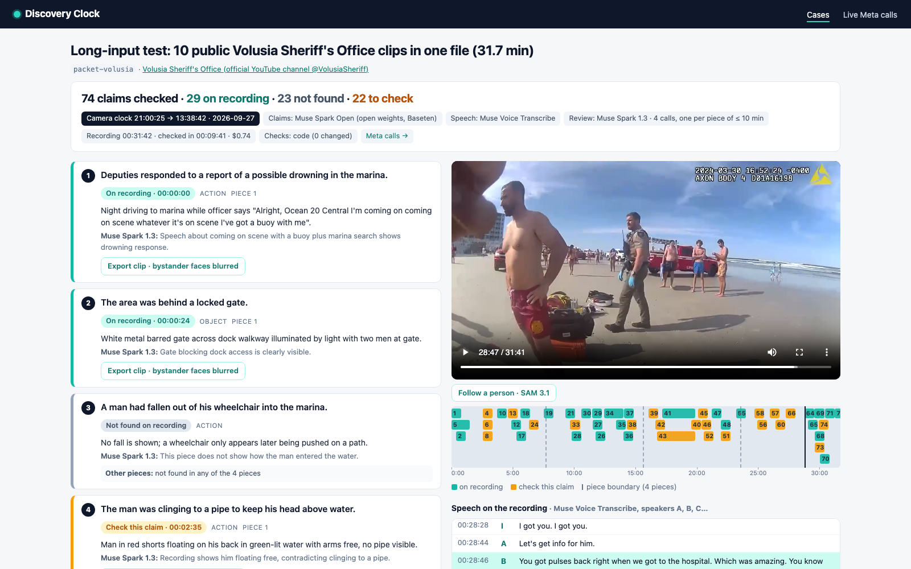

# Discovery Clock

**Checks every claim in a written incident report against the body-worn camera recording and points to the second where it is, or is not, on the video.**

For each claim in the report it returns **On recording** (with the timecode and what is seen or said there), **Not found on recording**, or **Check this claim** (the recording shows something different or only partly supports it). Click a claim and the player jumps to that second. It never says "the officer lied": it points a public defender or prosecutor to the second of footage, and the lawyer looks.

**Demo video (2:38):** VIDEO_URL · **Built:** all code in this repository was written on Nov 4, 2026, during the Meta Global AI Developer Hackathon.

**At a glance**
- **Tested on 5 public body-camera videos** (Volusia Sheriff's Office, 39 claims): all 5 planted contradictions came back as *check this claim*, 4 of the 5 planted invented claims as *not found* (1 as *check*), and none of the 10 as *on recording*; 21 of 29 claims from the agency's own written accounts got a timecode, 3 of them flagged *check*; 8 of 8 timecodes we checked against the frames by eye matched. Answer keys were sealed by hash before the first model run ([eval/RESULTS.md](eval/RESULTS.md)).
- **Long input:** a 31.7-minute file of 10 public Volusia clips joined together (a packet to test long input; real discovery holds hours from several cameras) was checked end to end in 9.7 minutes for $0.74: 4 pieces, one Muse Spark 1.3 call each. 50 of 51 timecodes landed inside the clip the claim belongs to, and none of the 20 planted claims came back as *on recording* ([Long recording](#long-recording)).
- **Live Meta calls on screen:** `/calls` shows every request and answer with latency and cost. A live run on a 3.7-minute video makes 4 calls and costs about $0.12.
- **Four Meta models, nothing else at runtime:** Muse Spark 1.3, Muse Voice Transcribe and SAM 3.1 on the Meta Model API; Muse Spark Open (open weights) on Baseten. Plain code checks every model answer and can only move a claim to *check*.
- **Run it without a key** (recorded live answers for all five cases are in `recordings/`):

```bash
python3.12 -m venv .venv && .venv/bin/pip install -r requirements.txt
python scripts/fetch_media.py fy6dRGapw_4
.venv/bin/python -m discovery_clock replay --case fisherman-fy6dRGapw_4 --video data/media/fy6dRGapw_4.mp4
DC_REPLAY=1 .venv/bin/python -m discovery_clock serve --port 8765   # open http://127.0.0.1:8765
```


## How it works

```
report text ──► Muse Spark Open (Baseten) ──► atomic claims + kind (action / speech / time / object)
video ──► Muse Voice Transcribe ──► speech turns with speakers and times
video ──► code stamps "t=N s" on every frame ──► Files API ──► Muse Spark 1.3 (video + turns + claims)
      ──► per claim: status, start_s, end_s, evidence, reason; camera clock read from the frames
      ──► code checks the model's answer (verify.py) ──► result.json ──► web page
SAM 3.1 on a short window ──► follow a person by click · find faces to blur in an exported clip
```

1. **Claims** (`claims.py`). Muse Spark Open splits the report into atomic claims. In evaluation mode each line is one claim and the model only labels the kind. If Baseten is unavailable, Muse Spark 1.3 does the same job; the page shows which model did it.
2. **Speech** (`meta.py`). Muse Voice Transcribe in diarization mode. Long audio is cut into pieces of at most 9:30 and the times are shifted back to the video clock.
3. **Placing claims** (`review.py`). One Muse Spark 1.3 call gets the video, the transcribed turns and the claims and returns JSON (strict schema). The same call reads the date and time the body camera burns into the frame (Axon overlay) at the start, at the end and at every camera switch.
   A recording longer than 12 minutes is cut into equal pieces of at most 10 minutes; each piece after the first starts 15 s early, so an event on a boundary is in two pieces. The whole recording is stamped once, so every piece shows the time of the full recording, and the pieces are cut from the stamped copy without re-encoding. Each piece gets one Muse Spark 1.3 call with all claims and the speech of that piece; three pieces run at a time. Code then merges the answers: per claim the best status wins (*on recording* over *check* over *not found*; between equals, the earlier timecode), an *on recording* that points outside the piece the model watched becomes *check*, and what the other pieces found is kept as a note on the claim. The checks in step 5 run unchanged over the merged answer.
4. **Time stamps** (`stamp.py`). In the first live test the model placed a claim at 1124 s in a 222 s video: video models read text in a frame well but lose track of elapsed time. So before upload the code burns `t=N s` into the top-left corner of every frame and the prompt tells the model to read times from it. After that change all timecodes on the test video fell inside the recording, and the ones we checked against the frames by eye matched. The player shows the original video; only the uploaded copy is stamped.
5. **Code checks the model** (`verify.py`). The model's answer is never shown as is:
   - a timecode outside the recording → *check*;
   - a quoted line of speech must exist in the transcript (fuzzy match ≥ 0.8 by words). Near the timecode: fine. Elsewhere in the recording: the status stays and the claim's window is widened to that line. Nowhere: the quote is invented → *check*;
   - *on recording* without visual or speech evidence, or with evidence that says the thing is not shown → *check*;
   - a clock time in the claim (for example "around 8:55 p.m.") is compared with the camera clock at the claim's timecode; more than 10 minutes apart → *check*, with both times in the note;
   - a claim the model did not answer → *check*.

   The code can only move a claim towards *check*, never to *on recording*. Every change is written next to the claim, and the model's original answer is kept. On the page a code change appears as an amber note above the evidence.
6. **SAM 3.1** (`track.py`). Only a window around the moment is sent, at 10 frames per second, because SAM video is billed per frame.
   - *Follow a person*: pause, click a person, and SAM tracks them through the window (point prompt, both directions). The box follows them during playback.
   - *Export clip with bystander faces blurred*: SAM finds the faces in the claim's window (concept prompt `face`); the code blurs each face frame by frame, except the person being followed, and keeps the audio.

## Models and where they run

| Model | Where | Used for |
|---|---|---|
| Muse Spark 1.3 (`muse-spark-1.3`) | Meta Model API | placing claims on the video, reading the camera clock |
| Muse Voice Transcribe (`muse-voice-transcribe-1.0`) | Meta Model API | speech with speakers and times |
| SAM 3.1 (`sam-3.1`) | Meta Model API | following a person, finding faces to blur |
| Muse Spark Open (`meta-models/muse-spark-open-1026`) | Baseten (open weights) | splitting the report into claims |

**No non-Meta model is called at runtime.** Everything else is plain code: verification, time stamps, blurring (Pillow), video cutting (ffmpeg).

## Live Meta calls on screen

`/calls` shows every request and answer as it happens: time (UTC), model, endpoint, the request in short, the answer (up to 2,000 characters), latency and cost. It refreshes every 2 seconds. Keys are never logged. Rows marked **REPLAY** re-serve a recorded live answer.


## Run it

Python 3.12, ffmpeg on PATH.

```bash
python3.12 -m venv .venv && .venv/bin/pip install -r requirements.txt
python scripts/fetch_media.py            # the public videos from the eval-media release (sha256 checked), YouTube as fallback
```

**Without a key (judges):** every live answer used for the five evaluation cases is recorded in `recordings/`. Replay runs the full pipeline, including the code checks, with no network:

```bash
.venv/bin/python -m discovery_clock replay --case fisherman-fy6dRGapw_4 --video data/media/fy6dRGapw_4.mp4
DC_REPLAY=1 .venv/bin/python -m discovery_clock serve --port 8765      # http://127.0.0.1:8765
```

Replaying all five evaluation cases this way gives exactly the numbers in `eval/RESULTS.md` (`python eval/run.py --results runs`).

The long-input case is replayed the same way after building its file from the ten clips (about a minute of encoding):

```bash
python scripts/make_packet.py            # data/media/packet-volusia.mp4, 31.7 min
.venv/bin/python -m discovery_clock replay --case packet-volusia --video data/media/packet-volusia.mp4
```

The five clips added for this test are in the `eval-media` release too (sha256 in `data/sources.json`), so the packet is built from byte-identical files and replays without "request changed".

A replay checks that each request matches the recorded one (hash of the full request, with uploaded files identified by the sha256 of the video). If a request differs — changed code, or a download of the video that is not byte-identical — the recorded answer for that step is still used and `/calls` marks the row "request changed since recording". In replay, SAM 3.1 answers exist for the recorded actions only: on the fisherman case, *Follow a person* at 00:02:40 and at 00:03:02 (the deputy on the dock; the second one is the live take shown in the video) and *Export clip* for claim 2.

**With a key:**

```bash
export MODEL_API_KEY=...            # Meta Model API
export BASETEN_API_KEY=...          # optional; without it Muse Spark 1.3 splits the claims
export DC_CAP_USD=3                 # spend cap; the next live call stops once the ledger reaches it
.venv/bin/python -m discovery_clock run --case my-case --video path/to/video.mp4 --report report.txt
.venv/bin/python -m discovery_clock run --case fisherman-fy6dRGapw_4 --video data/media/fy6dRGapw_4.mp4 \
    --report eval/cases/fisherman-fy6dRGapw_4/claims.txt --claims lines
.venv/bin/python -m discovery_clock serve --port 8765     # upload a video and a report in the browser
```

Results go to `runs/<case>/result.json`; the call log to `runs/<case>/calls.jsonl`; the spend ledger to `runs/ledger.jsonl`. `python -m discovery_clock reverify --case <id>` re-runs the code checks over the saved model answer without calling any model.

Tests: `.venv/bin/python -m pytest` (87 tests, no network).

## Evaluation

Five published body-camera videos of the Volusia Sheriff's Office (see *Data and rights*). For each video:

- **account** claims: sentences from the official written account the agency published with the video (names replaced);
- **planted** claims, written by us before any model run: one the recording contradicts (`planted_contradiction`) and one that is not in it (`planted_invented`). A planted claim must never come back as *on recording*.

The keys (`eval/cases/<id>/key.json`) carry these labels only, no expected timecodes. They were sealed before the first model run: `eval/SEALED.txt` holds `sha256(json.dumps(key, sort_keys=True))` for each case, and `eval/run.py` re-checks every seal and writes `eval/RESULTS.md`.

One live run per case, 39 claims (from `eval/RESULTS.md`):

| | result |
|---|---|
| planted claims kept off "on recording" | **10 / 10** |
| … planted contradictions flagged "check this claim" | **5 / 5** |
| … planted invented claims marked "not found" | 4 / 5 (1 marked "check") |
| official-account claims that got a timecode | 21 / 29 |
| … of which marked "check this claim" (listed in RESULTS.md with evidence and timecode for a human look) | 3 |
| official-account claims not found in the published clip | 8 |

**Rule change after run 1, disclosed.** In the first run the quote check moved a claim to *check* whenever a quoted line was more than 10 s from the claim's timecode. Housefire C3 quoted a real line spoken 18 seconds earlier and was wrongly moved to *check*. Rule v2: a quote found anywhere in the transcript keeps the status and widens the claim's window to that line; only a quote found nowhere moves the claim to *check*. All five cases were re-checked with v2 over the saved model answers (`python -m discovery_clock reverify`), without new model calls. The only change: housefire C3, *check* → *on recording* at 00:00:53–00:01:19. `eval/RESULTS.md` shows the as-run and v2 numbers side by side.

Spend for the five live runs: $0.07–$0.13 per case for videos of 1.6 to 4.3 minutes (Muse Spark 1.3 plus Voice Transcribe; Spark Open on Baseten credits). SAM 3.1 costs $0.02–$0.024 per 10–12 second window at 10 fps.

## Long recording

The five evaluation clips are 1.6 to 4.3 minutes long; the pain is hours of footage. To test long input we joined ten public clips of the Volusia Sheriff's Office (the five above and five more, see *Data and rights*) into one 31.7-minute file, in a fixed order (`scripts/make_packet.py`, offsets in `data/packets/volusia.json`). It is a packet of separate incidents, not one incident: it tests the pieces, the absolute timecodes and the merge; real discovery holds hours of footage from several cameras of one incident.

The claims are the 39 claims of the five evaluation clips, unchanged, plus 4–7 sentences from the agency's description of each new clip (3 for the speeder clip: its description is three short lines, so two of its claims come from the clip's title) and 2 planted claims per new clip: 74 claims, every claim tied to the clip it comes from. The key, with each clip's place in the file, was sealed before the run (`eval/SEALED.txt`).

One live run (`runs/packet-volusia`, recorded in `recordings/packet-volusia/`):

| | |
|---|---|
| video | 31:42 (1,901.7 s), one file, 10 clips |
| pieces | 4 pieces for Muse Spark 1.3: 7:55, then three of 8:10 (each after the first starts 15 s early); 4 pieces of up to 9:30 for Voice Transcribe |
| calls | 13: claims 1 (Muse Spark Open), speech 4, uploads 4, review 4 (3 at a time; each about 88k input and 11–13k output tokens, 67–80 s) |
| wall-clock | 9.7 min (581 s): speech 6.2 min, one piece after another (the stamped copy is made meanwhile); uploads 1 min; review 2.3 min |
| spend | $0.74 ($0.10 speech, $0.64 review; claims on Baseten credits) |
| claims | 74: 29 on recording, 22 to check, 23 not found |
| planted claims kept off "on recording" | **20 / 20** |
| timecoded claims inside their own clip (start time within the clip, ± 2 s) | **50 / 51** |
| official-account claims with a timecode | 40 / 54 |
| claims of the five evaluation clips, same status as in their own separate runs | 36 / 39 (with a timecode: 21 / 29 in both) |

The one timecode outside its clip: the planted claim "a passenger was riding on the back of the motorcycle" (motorcycle clip) was answered *check* at 00:16:03, on the motorcyclist of the next clip, "no second person on the motorcycle is visible". The status was right; the place was the wrong clip. Similar moments in different clips of a packet are the expected failure of this test, and the evaluation counts them.

By eye: 14 timecodes from all 4 pieces. For 8 visual claims the frame at the timecode shows what the model described (patrol car driving to the marina, the burning house, the deputy with the man in blue at the construction site, the man in orange, motorcycles from the air, the thermal camera over the water, the swimmer carried out of the surf, the single person in the spinning boat); for 6 speech claims the transcript has the line at that second ("three wheels", "50 miles an hour over the speed limit", "bail out … two black males", "You got pulses back", "He just kicked my partner", "one secure").

Watching the file once at normal speed takes 31.7 minutes; the run returned a timecode or *not found* for each of 74 claims in 9.7 minutes, most of it the speech step, which is not yet parallel. Per-clip numbers are in [eval/RESULTS.md](eval/RESULTS.md) (*Long input*).



## Data and rights

All videos come from the official YouTube channel of the Volusia Sheriff's Office (@VolusiaSheriff). They are public records under Florida law (Florida Statutes ch. 119), released by the agency; Florida agencies cannot claim copyright in public records (*Microdecisions, Inc. v. Skinner*, 889 So. 2d 871, Fla. 2d DCA 2004).

| case | video |
|---|---|
| fisherman-fy6dRGapw_4 | [Fisherman falls out of wheelchair into water - rescued!](https://www.youtube.com/watch?v=fy6dRGapw_4) |
| housefire-phHtxd9Ln3Q | [House fire rescue: 5/18/26](https://www.youtube.com/watch?v=phHtxd9Ln3Q) |
| i4driver-iqxWGjr1PRk | [I-4 reckless drunk driver](https://www.youtube.com/watch?v=iqxWGjr1PRk) |
| dog-kCu9d3LMN6A | [Dog saved from starving, owner arrested](https://www.youtube.com/watch?v=kCu9d3LMN6A) |
| motorcycle-r-ub7DZN8BA | [Fleeing motorcyclist arrest](https://www.youtube.com/watch?v=r-ub7DZN8BA) |

For the long-input test (*Long recording* above) five more clips of the same channel are used, joined with the five above into one file by `scripts/make_packet.py` (order and offsets in `data/packets/volusia.json`):

| clip | video |
|---|---|
| speeder-qLXQ1PO2aME | [120 mph Super Speeder arrest on I-95](https://www.youtube.com/watch?v=qLXQ1PO2aME) |
| gasthieves-cPrCvm5R7DI | [Gas thieves caught: 11/9/24](https://www.youtube.com/watch?v=cPrCvm5R7DI) |
| water-inKtyjwcU7E | [2 arrested in water: 6/6/24](https://www.youtube.com/watch?v=inKtyjwcU7E) |
| ocean-0WemYQrrIyM | [Ocean rescue: 3/30/24](https://www.youtube.com/watch?v=0WemYQrrIyM) |
| lakedias-cR5y4V4eGbI | [Lake Dias rescue: 2/4/25](https://www.youtube.com/watch?v=cR5y4V4eGbI) |

- No media is stored in git. All ten videos (the five evaluation clips and the five more used in the long-input packet) are attached, byte-identical to the files the recorded runs were made on, to the release [`eval-media`](https://github.com/retailbox-automation/discovery-clock/releases/tag/eval-media); `scripts/fetch_media.py` downloads them from there, checks the sha256 listed in `data/sources.json`, and falls back to YouTube (yt-dlp) only if that fails. The five clips added for the long-input test are not in the release; they come from YouTube.
- Names of arrested people are replaced in the claims.
- Bystanders' faces are blurred in anything we export or publish (SAM 3.1 finds the faces, the code blurs them).

## Limitations

- Five videos, 39 claims, one run each. That is a sanity check, not a benchmark.
- We wrote the evaluation keys ourselves (the labels and the planted claims); they were sealed by hash before the first run, but they are ours.
- The statuses are pointers for a human reviewer, not findings. *Not found* means the model did not find the claim in this clip; another camera or the full footage may show it.
- Muse Voice Transcribe returns turns, not word-level timestamps, so a quote is located to the turn (a few seconds), not to the word.
- Voice Transcribe takes up to 10 minutes per file; longer audio is cut into 9:30 pieces, transcribed one after another (the slowest step of a long run).
- Long input is tested on one file: a 31.7-minute packet of 10 short public clips joined together, reviewed in 4 pieces. It shows the pieces, the absolute timecodes and the merge working; it is not a test on real discovery, which holds hours of footage from several cameras of one incident. Claims of one clip can match a similar moment in another clip of the packet; the evaluation counts those.
- Times in claims are compared with the camera clock only when the claim states a clock time.
- SAM tracking works on a short window around the clicked moment (4 s before, 8 s after).

## Layout

```
discovery_clock/   meta.py (client, call log, spend cap, record/replay) · claims.py · stamp.py · review.py
                   verify.py · track.py (SAM) · pipeline.py · cli.py · app.py + templates/ + static/
eval/              cases/<id>/{claims.txt,key.json} · SEALED.txt · run.py · RESULTS.md
recordings/<case>/ recorded live answers (replay without a key)
data/              sources.json (videos, rights, sha256) · packets/volusia.json (clips and offsets of the long-input file)
scripts/           fetch_media.py · make_packet.py · run_eval_cases.sh
tests/             pytest, no network
```

License: MIT.
